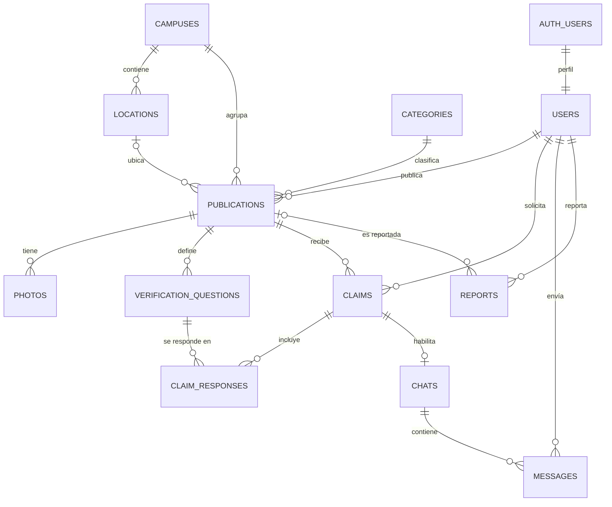

# Base de datos de CUCEI Found & Lost

| Archivo | Contenido |
|---|---|
| `schema.sql` | 12 tablas, restricciones, índices, triggers y políticas RLS. No inserta datos |
| `migration_campus_moderation.sql` | Columna `campuses.email_domain` y estado de publicación `suspended` |
| `functions.sql` | Operaciones atómicas que usa el backend y reglas de visibilidad de publicaciones moderadas |
| `storage_realtime.sql` | Bucket de fotos y Realtime para `messages` |
| `seeds.sql` | Campus CUCEI y categorías por defecto |

## Relaciones



## Tablas

| Tabla | Contenido | Reglas principales |
|---|---|---|
| `campuses` | Campus universitarios | Nombre y código únicos sin distinguir mayúsculas; `email_domain` es informativo y no controla el acceso |
| `users` | Perfil vinculado 1:1 con `auth.users` | Sin correo ni datos de contacto; `role` y `status` solo cambian desde el backend |
| `categories` | Categorías de objetos | Nombre único |
| `locations` | Ubicaciones dentro de un campus | Nombre único por campus |
| `publications` | Objetos perdidos (`lost`) o encontrados (`found`) | Campus obligatorio; la ubicación, si existe, debe ser de ese campus (llave compuesta) |
| `photos` | Fotografías de una publicación | Guarda la ruta en Storage, no una URL pública |
| `verification_questions` | Preguntas de quien publica | Solo el texto; **no guarda la respuesta correcta** |
| `claims` | Solicitudes de reclamación | Una abierta por persona y publicación; una aprobada por publicación |
| `claim_responses` | Respuestas del solicitante | Una por pregunta; solo mientras la reclamación esté pendiente |
| `chats` | Conversación de una reclamación aprobada | Una por reclamación; participantes derivados por trigger |
| `messages` | Mensajes de un chat | No se editan |
| `reports` | Reportes de publicaciones o usuarios | Exactamente un objetivo; sin duplicados abiertos; nadie se reporta a sí mismo |

### Estados

| Entidad | Estado | Significado |
|---|---|---|
| Publicación | `active` | Visible y abierta a reclamaciones |
| | `in_process` | Reclamación aprobada, entrega en curso |
| | `resolved` | Objeto devuelto |
| | `cancelled` | Retirada por quien publicó |
| | `suspended` | Oculta por moderación; un admin puede reactivarla si no tiene reportes abiertos |
| | `removed` | Dada de baja por moderación, de forma definitiva |
| Reclamación | `pending` | Esperando revisión |
| | `approved` | Aceptada; permite crear el chat |
| | `rejected` | Rechazada |
| | `cancelled` | Retirada, o aprobación revocada (cierra el chat) |

Transiciones válidas de una reclamación: `pending → approved | rejected | cancelled` y `approved → cancelled`. Un trigger rechaza cualquier otra.

Al borrar una cuenta en `auth.users` se eliminan en cascada su perfil, sus publicaciones, sus reclamaciones y los chats y mensajes asociados.

## Seguridad en tres capas

1. **Permisos por tabla y columna.** `anon` no tiene acceso a nada. `authenticated` solo puede escribir las columnas indicadas, así que un cliente no puede cambiar `role`, `status` ni aprobar reclamaciones. RLS filtra filas pero no columnas, por lo que esta capa es imprescindible.
2. **Políticas RLS.** Activas en las 12 tablas.
3. **Triggers de integridad.** Se aplican a todos, incluido el backend.

| Tabla | Lectura | Escritura desde el cliente |
|---|---|---|
| Catálogos | Usuarios activos, solo registros activos | Ninguna |
| `users` | Solo el propio perfil | Su `display_name` y `campus_id` |
| `publications` | Activas; las demás, quien publicó o reclamó | Crear; editar las propias mientras estén activas |
| `photos`, `verification_questions` | Igual que su publicación | Quien publicó |
| `claims` | Solicitante y quien publicó | Crear la propia |
| `claim_responses` | Solicitante y quien publicó | Solicitante, si está pendiente |
| `chats` | Sus dos participantes | Ninguna |
| `messages` | Sus dos participantes | Participantes, con el chat abierto |
| `reports` | Solo quien reportó | Crear el propio |

## Funciones y comprobaciones adicionales de RLS

Un cliente con sesión no basta: todas las políticas, salvo la lectura del propio perfil, exigen un perfil activo.

| Función en `private` | Usada por | Por qué hace falta |
|---|---|---|
| `is_active_user()` | Casi todas | Bloquea sesiones sin perfil y cuentas suspendidas |
| `owns_publication(id)` | `photos`, `verification_questions`, `claims` | Consulta una tabla con RLS propia |
| `has_claim_on_publication(id)` | `publications` | **Evita la recursión infinita** entre `publications` y `claims` |
| `can_view_publication(id)` | `photos`, `verification_questions`, `reports` | Reutiliza la regla de visibilidad |
| `is_open_claim_of_user(id)` | `claim_responses` | Comprueba dueño y estado de la reclamación |
| `can_view_claim(id)` | `claim_responses` | Une reclamación y publicación |
| `is_chat_participant(id)` | `messages` | Limita la lectura a los participantes |
| `can_send_message(id)` | `messages` | Además exige que el chat siga abierto |

Son `SECURITY DEFINER` con `search_path` vacío y viven en el esquema `private`, que la API de Supabase no expone.

`public.get_public_profiles(uuid[])` es la única función expuesta. Devuelve solo `id` y `display_name`, por ejemplo para mostrar el nombre de quien publicó sin dar acceso a la tabla `users`.

## Operaciones atómicas (`functions.sql`)

`supabase-js` no ofrece transacciones, así que los flujos que tocan varias tablas son funciones SQL. Solo `service_role` puede ejecutarlas, porque reciben la identidad como parámetro.

| Función | Efecto |
|---|---|
| `create_publication_with_questions` | Crea la publicación y sus preguntas |
| `replace_verification_questions` | Reemplaza las preguntas si no hay reclamaciones |
| `submit_claim` | Crea la reclamación con una respuesta por pregunta |
| `approve_claim` | Aprueba, pasa la publicación a `in_process` y crea el chat |
| `cancel_claim` | Cancela; si estaba aprobada, reabre la publicación y cierra el chat |
| `resolve_publication` | Marca como `resolved`, rechaza lo pendiente y cierra el chat |
| `cancel_publication` | Marca como `cancelled` y rechaza lo pendiente |
| `moderate_publication` | Marca como `suspended` o `removed`, cancela las reclamaciones abiertas y cierra el chat |

Cada una vuelve a validar permisos y estado con la fila bloqueada, para resolver peticiones simultáneas.

## Storage y Realtime (`storage_realtime.sql`)

| Elemento | Configuración |
|---|---|
| Bucket | `publication-photos`, privado |
| Tamaño máximo | 5 MB por archivo |
| Tipos permitidos | `image/jpeg`, `image/png`, `image/webp` |
| Políticas de `storage.objects` | Ninguna, a propósito: los clientes solo acceden con las URLs firmadas que entrega el backend |
| Realtime | Tabla `public.messages`; la entrega respeta las políticas RLS |

## Responsabilidades del backend

La clave `service_role` **omite RLS**, así que cada servicio comprueba en el servidor quién hace la petición.

- **Identidad:** sale siempre del token verificado con Supabase Auth, nunca del cuerpo de la petición.
- **Dominios institucionales:** se aceptan `udg.mx` y `alumnos.udg.mx` (variable `ALLOWED_EMAIL_DOMAINS`), con coincidencia exacta y correo confirmado. Por eso no aparecen en el SQL. Como cualquiera puede registrarse en Supabase Auth con la clave pública, es la existencia del perfil lo que da acceso: sin perfil, las políticas no devuelven nada.
- **Propiedad y participación:** cada servicio verifica quién publicó, quién reclamó y quién participa en el chat.
- **Administración:** el rol se lee del perfil en la base de datos en cada petición. El módulo `admin` no tiene acceso a mensajes ni a respuestas.

## Decisiones del modelo

- **Respuestas correctas:** no se guardan. Quien publica tiene el objeto y evalúa las respuestas manualmente.
- **Acceso:** todo requiere sesión de un usuario institucional activo.
- **Rol `admin`:** atiende reportes a través del backend; RLS no le da acceso a respuestas ni a mensajes.

## Pendiente

- **Datos iniciales:** ubicaciones dentro de cada campus.

## Ejecución manual en Supabase

Ejecuta los archivos en este orden, cada uno en una consulta nueva de **SQL Editor** (**New query**):

1. `schema.sql`: una sola vez; si se repite, falla porque los objetos ya existen.
2. `migration_campus_moderation.sql`: se puede repetir. Debe ir antes que `functions.sql`, que depende del estado `suspended`.
3. `functions.sql`: se puede repetir.
4. `storage_realtime.sql`: se puede repetir.
5. `seeds.sql`: se puede repetir sin duplicar registros.

Para cada uno, pega el contenido completo y pulsa **Run**. Si Supabase advierte sobre operaciones sensibles, confirma solo si estás en el proyecto correcto. Si algún archivo falla, corrige el problema y vuelve a ejecutarlo antes de seguir con el siguiente.

Para comprobar el resultado:

```sql
select tablename, rowsecurity
from pg_tables
where schemaname = 'public'
order by tablename;

select id, public, file_size_limit, allowed_mime_types
from storage.buckets
where id = 'publication-photos';

select tablename
from pg_publication_tables
where pubname = 'supabase_realtime' and tablename = 'messages';
```

La primera debe devolver 12 filas con `rowsecurity = true`; la segunda, el bucket privado con sus límites; la tercera, la tabla `messages`. El SQL Editor muestra solo el resultado de la última consulta, así que ejecútalas por separado.
